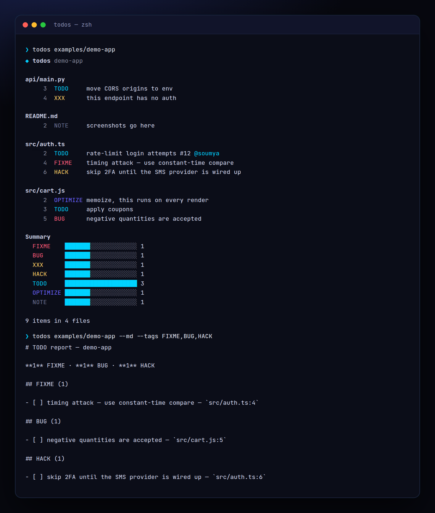

<!-- ═════════════ HEADER ═════════════ -->
<p align="center">
  
</p>

<p align="center">
  
</p>

<p align="center">
  <a href="https://github.com/krishyaa06/prism-todo-scanner/actions/workflows/ci.yml"></a>
  
  
  <a href="LICENSE"></a>
</p>

<p align="center">
  
</p>


## ⚡ Overview

**Prism TODO Scanner** (`todos`) walks your project (respecting `.gitignore`) and collects every `TODO`, `FIXME`, `BUG`, `HACK`, `XXX`, `OPTIMIZE`, `REVIEW` and `NOTE` comment in any language — `//`, `#`, `/* */`, `<!-- -->`, `--`, `;`. It understands `TODO(author):` and `#123` issue refs, can add who wrote each one and how long ago via `git blame`, and exports a Markdown checklist you can paste straight into a GitHub issue.

## ✨ Features

- Works in **any language**: `//`, `#`, `/* */`, `<!-- -->`, `--`, `;`, `%`
- Parses `TODO(author):` and `#123` / `GH-123` issue references
- `--blame` adds author + age (`3mo ago`); `--sort age` shows the oldest debt first
- `--md -o TODO.md` exports a checklist with optional GitHub links via `--repo`
- `--fail-on FIXME,BUG` and `--max <n>` for CI gates; `--json` for scripts
- `.gitignore`-aware, skips binaries / lockfiles / minified files. Zero dependencies

## 🚀 Quick Start

```bash
# run without installing
npx github:krishyaa06/prism-todo-scanner . --blame

# or install globally
npm install -g github:krishyaa06/prism-todo-scanner
todos --md -o TODO.md
```

Requires Node.js 18.17+. No dependencies.

## 🛠️ Usage

```text
todos [dir] [options]

  -t, --tags <list>     tags to find (default: TODO,FIXME,BUG,HACK,XXX,OPTIMIZE,REVIEW,NOTE)
  -b, --blame           add author + age from git blame
  -s, --sort <by>       file | tag | age
      --md              Markdown checklist
  -o, --out <file>      write --md output to a file
      --json            JSON output
      --repo <url>      link files in --md to a GitHub repo
      --fail-on <list>  exit 1 if any of these tags exist
      --max <n>         fail if more than n items in total
```

### Recognised formats

```js
// TODO: plain
// TODO(soumya): with author
# FIXME #42 with an issue ref
/* HACK: block comments */
<!-- NOTE: html / markdown -->
```

Lowercase `todo` only counts when followed by `:` or `(`, so `todoList` and "a todo app" are ignored.

### CI gate

```yaml
- run: npx --yes github:krishyaa06/prism-todo-scanner --fail-on FIXME,BUG
```

## 📁 Project Structure

```
prism-todo-scanner/
├── assets/
│   ├── logo.png
│   └── logo.svg
├── bin/
│   └── todos.js   # CLI entry
├── examples/
│   └── demo-app/   # sample project
│       ├── api/
│       │   └── main.py
│       ├── src/
│       │   ├── auth.ts
│       │   └── cart.js
│       └── README.md
├── src/
│   ├── index.js   # parser, scanner, blame, markdown
│   ├── ui.js   # colours, tables
│   └── walk.js   # gitignore-aware walker
├── test/
│   └── todos.test.js
├── .gitignore
├── LICENSE
└── package.json
```

## 🧪 Tests

```bash
npm test
```

Tests use the built-in `node:test` runner, so there is nothing to install. CI runs them on Node 20 and 22.

## 🤝 Contributing

1. Fork the repo and create a branch: `git checkout -b feature/my-idea`
2. Make your change and add a test in `test/`
3. Run `npm test` and open a Pull Request

## 🔷 Part of Prism Protocol

Prism TODO Scanner is one of the open-source tools built by [Prism Protocol](https://dc.gg/prismprotocol), a tech community where young builders learn, ship and compete together.

## 👤 Author

<table>
  <tr>
    <td align="center">
      <a href="https://github.com/krishyaa06"><br><b>Soumya Bhandare</b></a><br>
      <sub>Founder @ Prism Protocol</sub>
    </td>
    <td>
      <a href="https://dc.gg/prismprotocol"></a><br>
      <a href="https://instagram.com/prism_protocol_"></a><br>
      <a href="https://x.com/krishyaa06"></a>
    </td>
  </tr>
</table>

## 📄 License

Released under the [MIT License](LICENSE).

<p align="center">
  <b>If you like this project, consider giving it a ⭐</b><br>
  <sub>"Build. Create. Compete." · Made with ⚡ by Prism Protocol</sub>
</p>


